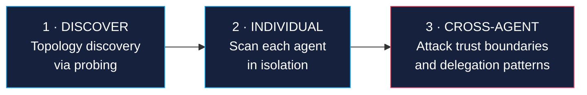

# Multi-Agent Coordination

ZIRAN can discover and test coordinated multi-agent systems — supervisors, routers, peer-to-peer networks, pipelines, and hierarchical architectures.

## Why Multi-Agent Testing Matters

Modern AI systems increasingly use multiple cooperating agents. A supervisor delegates tasks to specialized workers; a router dispatches requests to domain experts; agents pass context to each other through delegation chains. Each inter-agent boundary is a potential attack surface:

- **Trust boundary exploitation** — An attacker who compromises one agent may escalate through delegation chains
- **Cross-agent prompt injection** — Injected content in Agent A's response may be trusted by Agent B
- **Privilege escalation** — A worker agent may have capabilities the supervisor doesn't directly expose
- **Data leakage** — Full-context delegation patterns may forward sensitive information to less-privileged agents

## How It Works

The multi-agent scanner operates in three stages:



### Stage 1: Topology Discovery

ZIRAN probes the entry-point agent with targeted prompts to discover:

- Other agents in the system
- Delegation patterns (full context, task-only, tool calls)
- Trust boundaries (same process, network, cross-organization)
- Agent roles (supervisor, router, worker, specialist)

The discovered topology is classified as one of:

| Type | Description |
|------|-------------|
| **Supervisor** | One orchestrator delegates to multiple workers |
| **Router** | A routing agent dispatches to specialized agents |
| **Peer-to-Peer** | Agents communicate directly with each other |
| **Hierarchical** | Multi-level supervisor hierarchy |
| **Pipeline** | Sequential chain of agents (output → input) |

### Stage 2: Individual Scans

Each agent is scanned in isolation using the standard multi-phase campaign. Results are merged into a shared knowledge graph with agent-prefixed node IDs to avoid collisions.

### Stage 3: Cross-Agent Campaign

Using the entry-point agent, ZIRAN executes attacks that exploit inter-agent communication:

- Prompt injection that propagates through delegation chains
- Trust boundary probing across agent boundaries
- Privilege escalation through capability gaps between agents
- Data exfiltration via cross-agent context leakage

### Stage 4: Hop Tracing

After the cross-agent campaign, ZIRAN plants each multi-agent vector at every agent it has an
adapter for. The planted prompt is the vector's first prompt with a canary appended, such as
`ZIRAN-H0-3f9a1c2b7e`: `H0` is the hop it was planted at (its delegation distance from the
entry agent) and the hash ties it to the campaign, vector and agent. Every adapter is reset
before each plant.

Each adapter then reports where the canary appeared, through `get_state()`:

- the `conversation_history` entries that hold it;
- the tool calls in `memory["observed_tool_calls"]` or `memory["tool_observations"]` (and the
  planted agent's reply calls) whose arguments hold it, with the tool and the argument path.

Each trace in `result.propagation` gives the path from the planted agent to the furthest agent
reached, the furthest hop, and each agent's evidence. The path goes through agents that saw the
canary when the topology allows it; otherwise it is the shortest delegation path, so the hop is a
lower bound.

The planted agent's reply is also matched against the known topology of the other agents. Each
match is a leaked part: an id or name, an identifier-shaped capability (`lookup_invoice`, not
`search`), or a system-prompt sentence of four words or more. Sentences shared by two agents,
and boilerplate such as "You are a helpful assistant.", are not counted.

Tracing fails closed. An adapter reads the other agents' traffic only when its
`observes_delegated_traffic` property is true; the default is false. An adapter without it, a
topology agent with no adapter, and an adapter whose `get_state` fails are listed as
`unobserved`. A plant whose reset or request fails records its `error`. All of these are
unmeasured, not clean. A remote worker reached through its own endpoint sees only what ZIRAN sent
it, so an HTTP-only scan reports "unmeasured beyond hop 0".

Tracing costs one request per multi-agent vector (11 today) per adapter, sent one at a time.
It records target usage, and once the configured `max_campaign_tokens` or `max_cost` is reached,
the remaining plants are skipped as unmeasured. Pass `trace_hops=False` to
`run_multi_agent_campaign`, or `--no-trace-hops` to `ziran multi-agent-scan`, to skip the stage.

## Usage

### CLI

```bash
# Scan a multi-agent system
ziran multi-agent-scan --target target.yaml

# Comprehensive coverage, 10 concurrent attacks
ziran multi-agent-scan --target target.yaml --coverage comprehensive --concurrency 10

# Skip individual agent scans (cross-agent only)
ziran multi-agent-scan --target target.yaml --skip-individual
```

### Python API

```python
import asyncio
from ziran.application.multi_agent.scanner import MultiAgentScanner

scanner = MultiAgentScanner(
    adapters={"supervisor": sup_adapter, "worker": wrk_adapter},
    entry_point="supervisor",
)

result = asyncio.run(scanner.run_multi_agent_campaign())

print(f"Topology: {result.topology.topology_type}")
print(f"Agents scanned: {result.total_agents}")
print(f"Total vulnerabilities: {result.total_vulnerabilities}")
print(f"Cross-agent vulnerabilities: {result.cross_agent_vulnerabilities}")
```

## Attack Vectors

ZIRAN ships with 14 multi-agent attack vectors (category `multi_agent`, most in `ziran/application/attacks/vectors/multi_agent.yaml`), covering:

- **Cross-agent prompt injection** — Injected content that propagates through delegation
- **Delegation chain manipulation** — Exploiting trust between supervisor and worker agents
- **Shared memory poisoning** — Corrupting shared state between agents
- **Agent impersonation** — Impersonating other agents in the system
- **Routing bypass** — Redirecting requests to unintended agents
- **A2A Agent Card trust** — Unsigned, unverifiable or look-alike Agent Cards (see [A2A Protocol](a2a-protocol.md))

## Knowledge Graph

Discovered topologies are imported into the attack knowledge graph. Each agent becomes a node, each delegation or trust boundary becomes an edge. This enables cross-agent attack path analysis — finding multi-hop exploitation chains that span agent boundaries. Each step of a traced canary path is a `propagates_to` edge between agent nodes, carrying the vector, the canary and the hop.

`ziran multi-agent-scan` prints the furthest canary hop, adds a `propagation` block to
`multi_agent_summary.json`, and writes every trace to `propagation.json`.

## See Also

- [Architecture](architecture.md) — Overall system design
- [Trust Exploitation](romance-scan.md) — Multi-phase methodology used for individual agent scans
- [Knowledge Graph](knowledge-graph.md) — How the graph tracks cross-agent relationships
